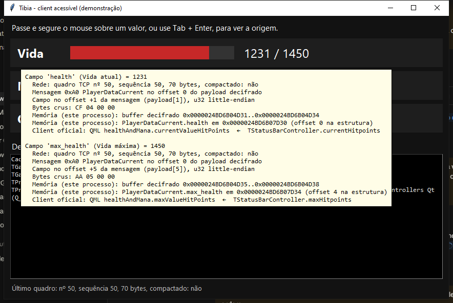
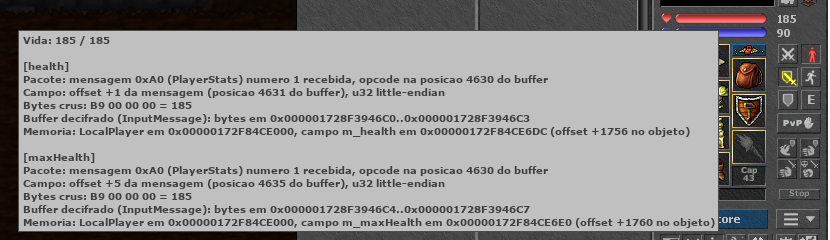
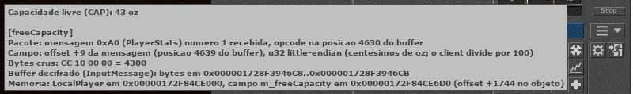

# Engenharia reversa do client do Tibia 15.33 para acessibilidade

Este documento descreve como o client oficial do Tibia (versão **15.33.9d148f**,
`client.exe` compilado em 12/10/2026) é construído e por qual caminho um dado
sai do servidor e chega até a interface. O objetivo é saber **onde** cada
informação existe, para que ferramentas de acessibilidade possam exibi-la de
outra forma (texto maior, leitura em voz, alto contraste, explicações).

Toda a análise foi **estática** sobre os arquivos instalados, mais um client
próprio de demonstração que reproduz o modelo do protocolo localmente. O client
oficial não foi modificado, não foi executado contra servidores oficiais e a
memória dele não foi lida. Veja a seção [Limites e regras](#limites-e-regras).

## 1. Visão geral da arquitetura

| Camada | Tecnologia observada | Evidência |
| --- | --- | --- |
| Executável | PE32+ x64, MSVC, sem packer (entropia normal da `.text`: 6,39) | `ferramentas/info_pe.py` |
| UI | Qt 6 + **Qt Quick/QML** (395 arquivos QML embutidos) | `ferramentas/extrair_qml.py` |
| Lógica C++ ↔ UI | Controllers `QObject` com `Q_PROPERTY` + sinais `NOTIFY` | `ferramentas/metadados_qt.py` |
| Rede | `Qt6Network` (TCP) + Crypto++ (`XTEA`, `RSAFunction`, `SHA1/SHA256`) + zlib 1.3.2 | RTTI e strings |
| Mensagens | **Protocol Buffers lite**: 621 tipos em `tibia::protobuf::protocol` | RTTI |
| Assets | Protobuf (`appearances.dat`, `staticdata.dat`, `map.dat`) + sprites BMP em LZMA | `ferramentas/analisar_assets.py` |
| Anti-cheat | BattlEye (`bin/BattlEye/BEService*.exe`, `tibia::client::TAntiCheatController`) | arquivos instalados, RTTI |
| Login | HTTPS JSON em `https://www.tibia.com/clientservices/loginservice.php` | strings |

O código C++ está organizado em namespaces `tibia::*`. Os maiores, pela contagem
de classes no RTTI: `protobuf::protocol` (621), `gamewindow` (268, os
controllers de tela), `input` (246, ações do jogador), `qmlcomponents` (57),
`game` (44), `appearances` (37), `network` (12) e `protocol` (10).

## 2. Técnicas usadas na análise

Cada técnica tem um script em `tibia-acessibilidade/ferramentas/`. Todos só leem
arquivos; rode com `python -I` (modo isolado).

1. **Manifesto do launcher.** `tibia/packages/Tibia/package.json` e `assets.json`
   listam cada arquivo com hash SHA-256 e tamanho. Serviram para conferir a
   instalação (1.496 arquivos do client e 7.094 assets, nenhum faltando).
2. **Cabeçalho PE** (`info_pe.py`). Seções, entropia por seção e DLLs
   importadas. Mostra um binário MSVC comum, sem compactação, que importa
   1.120 funções do `Qt6Core`, 224 do `Qt6Quick` e 118 do `Qt6Network`.
3. **RTTI do MSVC** (`listar_classes_rtti.py`). O compilador deixa nomes
   decorados como `.?AVTPlayerData@game@tibia@@`. Foram 2.197 classes, o que dá
   o mapa de módulos sem precisar desmontar código.
4. **Metadados do Qt (moc)** (`metadados_qt.py`). Toda classe `QObject` guarda
   em texto puro seus sinais, slots e propriedades. É isso que diz quais nomes a
   UI usa para ler cada valor (ex.: `currentHitpoints`).
5. **QML embutido** (`extrair_qml.py`). Os arquivos `.qml` ficam no recurso Qt
   dentro do `client.exe`, cada um precedido do tamanho em 4 bytes big-endian.
   O script recupera 395 arquivos e a tabela de nomes (UTF-16BE), por exemplo
   `StatusBar*.qml`, `BattleListEntry.qml`, `CharacterInfoDialog.qml`.
6. **Descritores protobuf** (`extrair_proto.py`). Mensagens protobuf "completas"
   guardam o `FileDescriptorProto` serializado no binário. O script reconstrói
   `appearances.proto`, `shared.proto`, `map.proto` e `sounds.proto`. As
   mensagens do protocolo de jogo usam protobuf *lite*, que não guarda
   descritores, então delas só se obtêm os nomes dos tipos.
7. **Formato dos assets** (`analisar_assets.py` + `protowire.py`). Leitura do
   formato de fio protobuf sem biblioteca externa e descompressão LZMA das
   folhas de sprites.
8. **Modelo dinâmico local** (`client-acessivel/`). Um servidor e um client
   próprios, em `127.0.0.1`, que reproduzem enquadramento, XTEA, zlib e a
   mensagem de status do jogador, para observar o caminho byte → memória → tela.

## 3. Assets: formatos e como chegam à tela

O índice é `assets/catalog-content.json`, com um registro por arquivo:

| Tipo | Arquivo | Formato |
| --- | --- | --- |
| `appearances` | `appearances-<sha256>.dat` (5,0 MB) | protobuf `tibia.protobuf.appearances.Appearances` |
| `staticdata` | `staticdata-<sha256>.dat` | protobuf: criaturas, raças, conquistas (nomes e textos) |
| `staticmapdata` | `staticmapdata-<sha256>.dat` | protobuf, 995 registros de topo |
| `map` | `map-<sha256>.dat` | protobuf: áreas ("Ab'Dendriel", "Carlin"...), NPCs, lista de `subarea-*.bmp.lzma` |
| `sprite` | 5.084 × `sprites-<sha256>.bmp.lzma` | BMP 384×384 32 bpp comprimido em LZMA |
| `fullmap` | `backdrop_map-<sha256>.jpg` | JPEG do mapa-múndi |
| `proficiencies` | `proficiencies-<sha256>.json` | JSON |

O nome de cada arquivo inclui o SHA-256 do conteúdo, então o launcher só baixa o
que mudou.

**`appearances.dat`** contém 43.516 objetos, 1.480 outfits, 243 efeitos e 76
mísseis. Cada `Appearance` tem `id`, `name`, `description`, `flags`
(64 campos, como `unpass`, `take`, `container`, `market`, `light`) e
`frame_group` → `sprite_info` → lista de `sprite_id`. Exemplo real: o objeto
102 se chama "white flower" e usa o sprite 197926. Para acessibilidade isso é
importante: **o nome de quase todo item já está no disco**, sem precisar da rede.

**Folha de sprites**: 24 bytes zero de preenchimento, a assinatura
`70 0A FA 80 24`, um varint com o tamanho comprimido, 5 bytes de propriedades
LZMA (`5D 00 00 00 02`), 8 bytes de tamanho e o fluxo LZMA. Descomprimido é um
BMP de 384×384 com sprites de 32×32 (ou 32×64, 64×32, 64×64, conforme
`spritetype` 0 a 3). O `catalog-content.json` diz quais IDs (`firstspriteid` a
`lastspriteid`) estão em cada folha; o maior ID é 301.201.

Caminho no client: `tibia::assets::TAssetManager`/`TAssetCatalog` lê o catálogo,
`tibia::appearances::TAppearancesManager` carrega o protobuf,
`tibia::sprites::TSpritesheetDecompressorThreadpool` descomprime as folhas,
`TSpriteResolver`/`TSpritesheetCache` acham o sprite de um `sprite_id`, e
`tibia::renderer::TSpriteTextureProvider` entrega a textura ao scenegraph do Qt
Quick (`TScenegraphNodeProvider`), que desenha o mapa.

## 4. Rede: do login ao objeto de mensagem

### 4.1 Login (HTTPS)

`tibia::authentication::TLoginRequestUploader` faz um POST JSON para
`loginservice.php`. As chaves encontradas no binário batem com o formato
conhecido: `email`, `password`, `token`, `stayloggedin`, e na resposta
`session` com `sessionkey`, `playdata`, `worlds` (com
`externaladdressprotected`/`externalportprotected` e as variantes
`unprotected`) e `characters` (com `ismaincharacter`, `previewstate`). O par
endereço/porta do mundo escolhido é usado na conexão de jogo.

### 4.2 Conexão de jogo (TCP)

As classes de `tibia::network` formam um pipeline, nesta ordem:

```
TGameserverTCPConnection                (QTcpSocket, bytes crus)
  → TGameserverNetworkPacketConnection
  → TGameserverNetworkPacketRawDataProcessor     (XTEA + inflate)
  → TGameserverNetworkPacketSequenceFlowProcessor (número de sequência)
  → TGameserverNetworkPacketReader
  → tibia::protocol::TProtocolServerMessageProcessor / TProtocolReader
  → TProtobufServerMessageTranslator              (bytes → GameserverMessage*)
  → TProtocolMessageQueue                         (sinais Qt)
```

O primeiro pacote do client vai cifrado com RSA (`CryptoPP::RSAFunction`) e
carrega a chave XTEA da sessão; daí em diante os dois lados usam XTEA
(`CryptoPP::XTEA`, 32 rodadas, blocos de 8 bytes). Há suporte a compressão
(zlib 1.3.2 e `CryptoPP::Deflator`) e a número de sequência por pacote
(`TPacketSequenceNumber`). Também existe um `TGameserverDualConnection`, sinal
de que o client consegue manter duas conexões com o mundo (endereço protegido e
não protegido).

O enquadramento usado no client de demonstração é o do servidor open source
Canary: `[u16 tamanho][u32 sequência, bit 31 = comprimido][XTEA(u8 padding,
mensagens..., padding)]`. Ele **não** foi conferido byte a byte no 15.33.

### 4.3 Mensagens viram objetos protobuf

O 15.x converte cada mensagem do servidor em um objeto protobuf
`tibia::protobuf::protocol::GameserverMessage<Nome>`. Os nomes dos tipos
aparecem no enum `GAMESERVER_MESSAGE_TYPE_*` (157 nomes no total, somando
cliente e servidor). Alguns relevantes para acessibilidade:

| Tipo | Conteúdo |
| --- | --- |
| `PLAYERDATACURRENT` | vida, mana, capacidade, experiência, nível, soul, stamina... |
| `PLAYERDATABASIC` | dados fixos do personagem (vocação, premium...) |
| `PLAYERSKILLS` | skills e magic level |
| `PLAYERSTATE` | condições (envenenado, queimando, paralisado, PZ...) |
| `PLAYERINVENTORY`, `SETINVENTORY` | itens equipados |
| `CREATUREHEALTH`, `CREATUREDATA`, `MOVECREATURE` | criaturas na tela |
| `TALK`, `MESSAGE`, `CHANNELS` | chat e mensagens de servidor |
| `TOPROW`, `BOTTOMROW`, `LEFTROW`, `RIGHTROW`, `FULLMAP`, `FIELDDATA` | mapa |
| `GRAPHICALEFFECTS`, `SOUNDTRIGGER` | efeitos e sons |

`TProtocolMessageQueue` tem um sinal Qt por tipo, por exemplo
`receivedPlayerDataCurrentMessage(std::shared_ptr<GameserverMessagePlayerDataCurrent>)`
(lido do moc em `0x1BF8AA5`). Cada `*ProtocolMessageHandler` se conecta aos
sinais que interessam.

O client também tem um gravador e um reprodutor de sessões
(`tibia::sessiondump::TClientSessiondumpRecorder`, `TSessiondumpPlayer`,
`TUnencryptedRawMessageStream`), usados no tutorial. Esse é o mecanismo
oficial de "replay" e mostra que o mesmo pipeline de mensagens funciona a
partir de um arquivo, sem rede.

## 5. Do objeto de mensagem até a UI

### 5.1 Vida e Mana

```
GameserverMessagePlayerDataCurrent
  → TProtocolMessageQueue::receivedPlayerDataCurrentMessage
  → tibia::game::TPlayerProtocolMessageHandler
  → tibia::game::TPlayerData                       (sinal playerDataChanged)
  → tibia::gamewindow::TStatusBarController        (Q_PROPERTY)
        currentHitpoints, maxHitpoints, hitpointsPercent,
        currentMana, maxMana, manaPercent,
        manaShield, maxManaShield, manaShieldPercent
        NOTIFY hitpiontManaValuesChanged            (grafado assim no binário)
  → QML StatusBar* / healthAndMana
        currentValueHitPoints = Qt.binding(... currentHitpoints)
        text: currentValueHitPoints + "/" + maxValueHitPoints
```

Trecho real do QML extraído (`healthAndMana`):

```qml
property int maxValueHitPoints: 0
property int currentValueHitPoints: 0
...
text: currentValueHitPoints + "/" + maxValueHitPoints
```

### 5.2 Capacidade (CAP)

```
GameserverMessagePlayerDataCurrent
  → TPlayerProtocolMessageHandler → TPlayerData (playerDataChanged)
  → tibia::gamewindow::TPlayerInventoryAndStatusController
        slot onPlayerDataChanged
        Q_PROPERTY capacity, hasZeroCapacity, hasCapacityBoost, soulpoints
        NOTIFY capacityChanged
  → QML inventorySidebarWidget
        capacityValue = Qt.binding(function() { return panelController.capacity; })
        hasZeroCapacity = Qt.binding(function() { return panelController.hasZeroCapacity; })
        item.slotText = capacityValue   (componente soulOrCapacityComponent)
```

O servidor manda a capacidade livre em centésimos de onça; a UI divide por 100.

### 5.3 O padrão geral

Toda tela segue o mesmo desenho, o que é bom para acessibilidade:

1. **Handler** (`T*ProtocolMessageHandler`) recebe o objeto protobuf.
2. **Storage/estado** (`TPlayerData`, `TStatusbarStorage`, `TCooldownStorage`,
   `TTraderStorage`...) guarda o valor e emite um sinal.
3. **Controller** (`tibia::gamewindow::T*Controller`) expõe `Q_PROPERTY` com
   nomes estáveis e legíveis.
4. **QML** faz `Qt.binding` nessas propriedades e desenha.

Ou seja, o melhor ponto para uma camada de acessibilidade seria a borda
controller → QML, onde os nomes são claros (`currentHitpoints`, `capacity`,
`playerStates`). Só que isso exigiria injetar código no processo oficial, o que
não é permitido (veja abaixo). Por isso o client de demonstração reproduz essa
cadeia do lado de fora.

## 6. Client acessível de demonstração

Pasta `tibia-acessibilidade/client-acessivel/`:

* `protocolo.py`: XTEA, enquadramento, zlib e a mensagem `0xA0`
  PlayerDataCurrent, guardada em uma `ctypes.Structure`.
* `servidor_demo.py`: servidor só em `127.0.0.1` que envia status simulados.
* `client_acessivel.py`: janela com Vida, Mana e CAP em fonte grande e alto
  contraste. Ao **passar e segurar o mouse** (0,7 s) aparece um tooltip com:
  quadro TCP e sequência, se veio comprimido, offset do campo na mensagem,
  bytes crus, endereço do byte no buffer decifrado e endereço do campo na
  estrutura em memória deste processo, e a propriedade equivalente no client
  oficial. Pelo teclado: `Tab` foca um valor e `Enter`/`F1` mostra o mesmo
  texto num painel selecionável.
* `teste_protocolo.py`: confere cifra, compressão e se os endereços mostrados
  apontam mesmo para os valores.



Os endereços do tooltip são do **nosso** processo, que é o único lugar onde é
legítimo apontar memória. Eles mudam a cada execução (ASLR e alocação dinâmica).

## 6.1 Client de jogo real com tooltips: OTClient + servidor Canary local

O simulador acima serviu para validar a ideia. A versão de verdade usa um client
de jogo completo e open source (OTClient 4.1) conectado a um servidor de testes
também open source (Canary 3.6.1, protocolo 15.11), tudo em `127.0.0.1`, com os
gráficos copiados do client oficial 15.33.

Ambiente (pasta `local/`, fora do git; scripts em `tibia-acessibilidade/servidor-local/`):

| Peça | Onde | Porta |
| --- | --- | --- |
| Banco MariaDB do XAMPP, base `canary_teste` (`schema.sql` do Canary) | `C:\xampp\mysql` | 127.0.0.1:3306 |
| Servidor Canary 3.6.1 + mapa `otservbr.otbm`, `bindOnlyGlobalAddress = true` | `local/canary` | 127.0.0.1:7171/7172 |
| Login HTTP próprio (`login.php`), mesmo JSON do `loginservice.php` oficial | PHP do XAMPP | 127.0.0.1:8080 |
| OTClient 4.1 compilado com o patch de acessibilidade | `local/otclient/otclient.exe` | — |

Ajustes necessários e por quê:

* **Login por HTTP.** No protocolo 15.x o Canary recusa o login antigo pela
  porta 7171 (só aceita o protocolo 11.00). O `login.php` responde no formato
  observado no `client.exe` (`session.sessionkey`, `playdata.worlds`,
  `playdata.characters`) e usa a chave de sessão `email\nsenha` que o Canary
  espera com `authType = "password"`.
* **Assets 15.33 no OTClient 15.11.** Os sprites e o `appearances.dat` do 15.33
  funcionam, mas o `staticdata.dat` mudou de esquema e o OTClient recusava o
  arquivo inteiro. `ferramentas/adaptar_staticdata_otclient.py` gera uma cópia
  só com as entradas compatíveis (descarta 105 de 2.766).
* **Compilação.** Visual Studio 2022 (toolset v143) + vcpkg clonado em
  `local/vcpkg` (`servidor-local/compilar_otclient.bat`). A dependência ANGLE
  foi removida do `vcpkg.json` porque a versão OpenGL não usa, e o download
  dela pelo `chromium.googlesource.com` falhava.
* O download automático de assets do OTClient (repositório de terceiros) ficou
  desligado; os assets vêm só do client oficial instalado em `tibia/`.

**O patch** (`tibia-acessibilidade/otclient-patch/acessibilidade.patch`):

1. `ProtocolGame::parsePlayerStats` (C++): antes de ler `health`, `maxHealth`,
   `freeCapacity`, `mana` e `maxMana`, anota a posição do opcode `0xA0` no
   buffer, o offset do campo dentro da mensagem, os bytes crus e o endereço
   desses bytes no buffer decifrado do `InputMessage`.
2. `LocalPlayer::getStatOrigins()` (C++, exposto ao Lua): junta essa origem com
   o endereço do objeto `LocalPlayer` e do campo (`m_health`, `m_mana`,
   `m_freeCapacity`...) e o offset do campo dentro do objeto.
3. Módulos Lua `game_healthinfo` e `game_inventory`: ligam o mouse nos painéis
   (eram "phantom") e põem esse texto como tooltip, atualizado a cada mudança.

Resultado real, segurando o mouse sobre a barra de vida:



E sobre o CAP:



O que os números mostram, conferidos no jogo: a mensagem `0xA0` começa com
`health` no offset +1 (`B9 00 00 00` = 185), `maxHealth` no +5 e `freeCapacity`
no +9 (`CC 10 00 00` = 4300 centésimos de oz, exibido como 43). Dentro do
`LocalPlayer`, `m_freeCapacity` fica no offset +1744 e `m_health` no +1756 nesta
compilação. Esse layout de pacote é o do protocolo 15.11 entre Canary e
OTClient; ele bate com o modelo usado no simulador, mas continua não
verificado contra o client oficial 15.33.

## 7. O que é observado e o que é inferido

| Afirmação | Situação |
| --- | --- |
| Qt 6/QML, nomes de classes, namespaces, sinais e `Q_PROPERTY` | **Observado** no binário |
| Cadeia `TStatusBarController` → QML e `TPlayerInventoryAndStatusController.capacity` → QML | **Observado** (moc + QML) |
| Ordem do pipeline de rede | **Inferido** dos nomes das classes |
| Uso de XTEA, RSA, zlib, número de sequência | **Observado** (RTTI/strings); detalhes de uso inferidos |
| Formatos de `appearances.dat`, sprites, `map.dat` | **Observado** (decodificados) |
| Layout byte a byte de PlayerDataCurrent no protocolo 15.11 (Canary ↔ OTClient) | **Observado** no OTClient patcheado |
| O mesmo layout no client oficial 15.33 | **Inferido**; não verificado |

Para confirmar o layout exato seria preciso desmontar
`TProtobufServerMessageTranslator` (por exemplo com Ghidra via REA) ou ter um
servidor de testes próprio compatível com o 15.33.

## 8. Limites e regras

* O client oficial roda com BattlEye. Ler ou alterar a memória dele, injetar
  DLL ou interceptar o tráfego cifrado de um servidor oficial viola as Tibia
  Rules, pode levar a banimento e não foi feito.
* Nada aqui conecta a servidores oficiais. O client de demonstração recusa
  qualquer host que não seja loopback.
* A pasta `tibia/` (client, assets e imagens extraídas em `tibia/_extraido`)
  fica fora do git, porque é conteúdo da CipSoft.

## 9. Como reproduzir

```bash
python -I tibia-acessibilidade/ferramentas/info_pe.py tibia/packages/Tibia/bin/client.exe
python -I tibia-acessibilidade/ferramentas/listar_classes_rtti.py tibia/packages/Tibia/bin/client.exe network
python -I tibia-acessibilidade/ferramentas/metadados_qt.py tibia/packages/Tibia/bin/client.exe tibia::gamewindow::TStatusBarController
python -I tibia-acessibilidade/ferramentas/extrair_qml.py tibia/packages/Tibia/bin/client.exe tibia/_extraido/qml
python -I tibia-acessibilidade/ferramentas/extrair_proto.py tibia/packages/Tibia/bin/client.exe tibia/_extraido/proto
python -I tibia-acessibilidade/ferramentas/analisar_assets.py tibia/packages/Tibia --extrair-sprite 0
python -I tibia-acessibilidade/client-acessivel/teste_protocolo.py
python -I tibia-acessibilidade/client-acessivel/servidor_demo.py
python -I tibia-acessibilidade/client-acessivel/client_acessivel.py
```

Os dois últimos rodam em terminais separados.

Ambiente Canary + OTClient (depois de montar `local/` como descrito em 6.1):

```bash
tibia-acessibilidade\servidor-local\compilar_otclient.bat
tibia-acessibilidade\servidor-local\iniciar_tudo.bat
```

Conta de teste do `schema.sql` do Canary: email `@god`, senha `god`.
